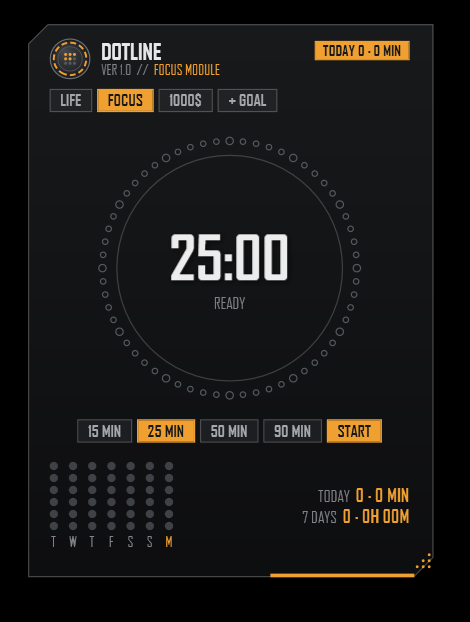

# NovaShield HUD

A tactical HUD layer for the Windows desktop: a keyboard launcher, desktop widgets, a focus
timer and a live world map on your wallpaper, all in one
gunmetal-and-amber style.

**Website and downloads:** <https://muchkurisrivardhan.github.io/NovaShieldHUD/>

| Part | What it is |
|---|---|
| **[Beacon](beacon/)** | A Spotlight-style launcher. `Alt+Space`, type, Enter. Apps, files, windows, system commands, timers, plain-English sentences, local voice, and Claude for anything else. |
| **[Dotline](dotline/)** | Desktop widgets that sit on your wallpaper: your life and your goals as dots, a focus timer, and time zones on a world-map wallpaper. Set up through Beacon, always in Beacon's style. |
| **[Filee](filee/)** | Drag-and-drop file converter. Hold `Ctrl`, drag files, drop them on a format in the ring that opens at your cursor: 270 formats, offline. A fork of the open-source [Filee](https://github.com/KnifeLemon/Filee) (MIT) that wears Beacon's style, live. |



## Setup guide

### 1. Install

1. Download the installer for your PC from the [website](https://muchkurisrivardhan.github.io/vantage/#download)
   or [GitHub Releases](https://github.com/muchkurisrivardhan/vantage/releases/latest):
   - `NovaShieldHUD-Setup-x64.exe`: Intel and AMD PCs
   - `NovaShieldHUD-Setup-arm64.exe`: Snapdragon and other ARM PCs
   (Not sure? Settings > System > About > *System type*.)
2. Run it. It installs for you only, in `%LOCALAPPDATA%\Programs\NovaShield HUD`: no admin
   prompt, and nothing else to download (.NET is included).
3. Windows may warn about an unrecognised app, because the installer isn't code-signed yet:
   **More info > Run anyway**. If **Smart App Control** is on, Windows blocks unsigned apps
   outright and there's no Run anyway; it can't be installed on that PC until releases are signed.
4. Finish starts Beacon. Its icon is in the tray; press `Alt+Space`.

### 2. Make it yours

Everything is in **Beacon Settings** (tray icon > Settings, or type `settings`):

| Page | What to set |
|---|---|
| **General** | Start Beacon when you sign in, the launcher shortcut, **Check for updates** |
| **Appearance** | The style (Tactical, HUD, Classic, Cyberpunk, Retro CRT, Minimal mono) and accent colour. Dotline follows |
| **Dotline** | Your birthday and lifespan, dot size, background, lock positions, time-zone dots |
| **Filee** | Start with Beacon, follow Beacon's look (with a live preview of the ring), ring size and opacity, captions, pause |
| **Voice** | Download a Whisper model to speak instead of typing (`Alt+M`) |
| **Plain English** | Your Anthropic API key, only if you want `?` / Claude |

### 3. Updates

Beacon never checks by itself. Settings > General > **Check for updates** asks GitHub for the
latest release; **Update** downloads the installer, checks it against the SHA-256 published
with the release, installs it over the old version and restarts Beacon. Settings are kept.

For maintainers: push a tag like `v0.6.0` and [the release workflow](.github/workflows/release.yml)
builds both installers, runs the self-tests and publishes the release that Update offers.

### 4. Uninstall

Settings > Apps > Installed apps > **NovaShield HUD** > Uninstall. It stops the apps. Your settings folders (below)
are left for a reinstall; delete them to remove every trace.

## What this does NOT touch

- **Signing in.** No credential provider: Windows sign-in, PIN, password and Windows Hello are
  untouched. No auto-login, no second password screen.
- **Windows itself.** No code injected into, hooked into or replaced in any Windows process. No
  system files or their permissions. Defender, SmartScreen, UAC and the lock itself stay on.
- **Admin rights.** The apps need none.
- **Other users.** Everything is per user: the install and the settings.
- **The network,** except: Filee's optional engine downloads (FFmpeg, LibreOffice, ... only when a
  conversion needs one and you agree), Claude (only when you ask it, with your own key), website icons in
  the launcher (can be turned off), the Whisper model you choose to download, and GitHub
  when you click Check for updates. No telemetry, no account, no ads.

## Where your data lives

All state is local, per Windows user:

| Path | Contents |
|---|---|
| `%APPDATA%\Beacon\` | settings (API key encrypted with Windows DPAPI), timers, usage counts |
| `%APPDATA%\Dotline\state.json` | birthday, goals, widget layout, focus log, map zones |
| `%APPDATA%\Filee\` | Filee's settings, presets and history; `theme.json` is Beacon's look, written by Beacon |
| `%APPDATA%\NovaShieldHUD\` | hand-off file between the apps: the running focus session |

Details in [SECURITY.md](SECURITY.md).

## Build from source

Windows 10/11, .NET 10 SDK.

```bash
dotnet build -c Release beacon/Beacon.csproj
dotnet publish -c Release -o dotline/dist dotline/Dotline.csproj
dotnet build -c Release filee/src/Filee.App/Filee.App.csproj
```

Run `beacon/bin/Release/net10.0-windows/Beacon.exe`; it finds and starts the others.

Self-tests:

```bash
dotnet dotline/bin/Release/net10.0-windows/Dotline.dll --selftest
```

The installer (needs [Inno Setup 6](https://jrsoftware.org/isinfo.php): `winget install JRSoftware.InnoSetup`):

```bash
powershell -ExecutionPolicy Bypass -File installer/build.ps1 -Arch x64 -Version 0.5.0
```

Every feature, with how it works: [docs/FEATURES.md](docs/FEATURES.md). History: [CHANGELOG.md](CHANGELOG.md).

## Licence

Not open source. The app is free to install and use; the source is public to read and review;
all other rights are reserved. See [LICENSE](LICENSE). The exception is [filee/](filee/), a fork of
Filee that stays under its own MIT licence ([filee/LICENSE](filee/LICENSE)). The open-source components it includes,
and their licences, are listed in [THIRD-PARTY-NOTICES.txt](THIRD-PARTY-NOTICES.txt).

Windows is a trademark of Microsoft Corporation; Claude is a trademark of Anthropic, PBC.
NovaShield HUD isn't affiliated with either.

## Support it

It's made by one person. [Sponsor on GitHub](https://github.com/sponsors/muchkurisrivardhan) or [buy me a coffee](https://buymeacoffee.com/srivardhanmuchuri).
