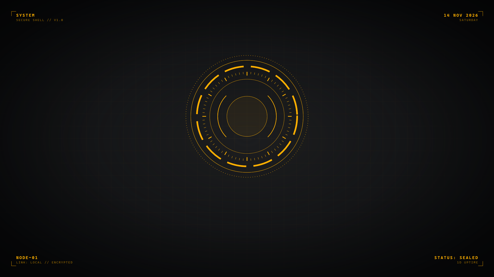

# Lockscreen

A HUD picture for the real Windows lock screen and sign-in screen: charcoal background, grid,
scanlines, a ring assembly that frames your account picture, and four corner readouts. It
follows Beacon's style, so the lock screen matches the launcher and the widgets.



**Status: milestone 1 of 6.** The renderer and preview work. Setting the picture as the lock
screen, the account emblem, lock screen widgets and scheduled refresh are not built yet.

## Try it

```bash
dotnet build -c Release lockscreen/Lockscreen.csproj
```

```bash
lockscreen/bin/Release/net10.0-windows/Lockscreen.exe --preview hud.png
```

| Option | What it does |
|---|---|
| `--preview <out.png>` | Render to a file. Changes nothing on the PC |
| `--theme <name>` | `amber`, `cyan`, `phosphor`, `redalert`, `mono`, `neon`, `custom`, or `beacon` (default) |
| `--size <W>x<H>` | Render at this size instead of the primary monitor's real pixels |
| `--debug-zones` | Outline the areas kept clear for the Windows clock and the sign-in box |
| `--selftest` | Config parsing, tokens, theme math and a check of the rendered picture |

## Themes

`beacon` (the default) follows Beacon's style: Tactical → amber, HUD → cyan, Retro CRT →
phosphor, Cyberpunk → neon, Minimal mono → mono, Classic → your accent colour. An accent
colour chosen in Beacon replaces the theme's own.

| Theme | Accent | Background |
|---|---|---|
| `amber` | `#FFB000` | `#0E0F11` |
| `cyan` | `#00E5FF` | `#0A0F14` |
| `phosphor` | `#33FF66` | `#0A0F0B` |
| `redalert` | `#FF3B3B` | `#120A0A` |
| `mono` | `#E8E8E8` | `#0C0C0C` |
| `neon` | `#FF2E97` | `#12041F` |

## Configuration

`%LOCALAPPDATA%\LockscreenWidget\config.json`, created with defaults on first run. A value
that isn't valid is replaced by its default and reported as a warning; the rest of the file
still applies.

```json
{
  "theme": "beacon",
  "ringCenter": { "x": 0.5, "y": 0.42 },
  "ringScale": 1.0,
  "corners": {
    "topLeft":     ["SYSTEM", "SECURE SHELL // v1.0"],
    "topRight":    ["{DATE}", "{WEEKDAY}"],
    "bottomLeft":  ["NODE-01", "LINK: LOCAL // ENCRYPTED"],
    "bottomRight": ["STATUS: SEALED", "{UPTIME_DAYS}D UPTIME"]
  },
  "effects": { "grid": true, "scanlines": true, "vignette": true, "glow": true },
  "widgets": { "nodeLabel": "NODE-01", "countdown": { "label": "TARGET", "date": "2027-01-01" } },
  "refreshMinutes": 60
}
```

A custom theme: set `"theme": "custom"` and add
`"customTheme": { "accent": "#RRGGBB", "background": "#RRGGBB", "dimOpacity": 0.55, "glow": 1.0 }`.

Corner text tokens: `{DATE}`, `{WEEKDAY}`, `{DAY_OF_YEAR}`, `{YEAR_PROGRESS}`,
`{UPTIME_DAYS}`, `{COUNTDOWN:YYYY-MM-DD}`. There is no time-of-day token: Windows shows a
live clock, and a time baked into a picture goes stale.

## What it shows, and what it never will

Anyone at the keyboard can read the lock screen. The picture only carries the corner text
you type and the tokens above: no user name, PC name, IP address, email, notifications, file
names or calendar details.

## What this does NOT touch

- No code is injected into, hooked into, or replaced in any Windows process.
- No credential provider: Windows sign-in, PIN, password and Windows Hello are untouched.
- No system files or their permissions; Defender, SmartScreen, UAC and the lock itself stay on.
- No auto-login, no second password screen.
- No network calls, no telemetry.
